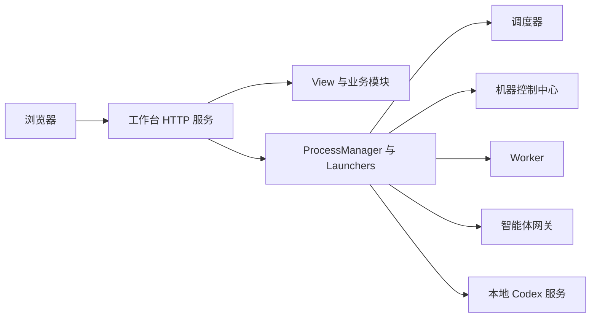

# SelfAgent 架构

## 功能概述

本仓库包含本地工作台、机器控制工具、代码检查工具、智能体及示例。工作台提供操作入口，编排多个拥有独立入口的运行单元。以下为 2026-11-16 基于现有代码的初步架构基线，并非完整接口审计。

## 模块文档

- [模块边界](模块边界.md)
- [架构维护流程](架构维护流程.md)
- [Goal-架构治理计划](Goal-架构治理计划.md)
- [入口清单](入口清单.md)
- [架构治理实施计划表](架构治理实施计划表.md)
- [范围与排除项](范围与排除项.md)
- [依赖矩阵](依赖矩阵.md)
- [验证记录](验证记录.md)
- [持续维护](持续维护.md)

## 当前模块

| 目录 | 当前职责 | 事实依据 |
| --- | --- | --- |
| workbench/machine-dashboard-server | HTTP 页面与 API、进程管理、任务与调度、配置和存储 | [server.py](../../workbench/machine-dashboard-server/src/server.py)、[工作台规则](../../workbench/machine-dashboard-server/AGENTS.md) |
| Tools/machine-control | 中央服务器、Worker、共享协议和客户端打包 | [README](../../Tools/machine-control/README.md) |
| Tools/code-review-agent | Git 增量、规则发现、确定性检查、模型审查和成功基线 | [README](../../Tools/code-review-agent/README.md)、[流程](../../Tools/code-review-agent/docs/architecture.md) |
| Tools/local_codex | 本地 Codex 相关工具；详细接口待核对 | 目录现状；不能据目录名推断全部职责 |
| AiAgent/AiProject/Codes/Agents/OpenAiAgent | 智能体 CLI、认证和本地模型网关 | [README](../../AiAgent/AiProject/Codes/Agents/OpenAiAgent/README.md) |
| AiAgent/AiProject/Codes/Demos | 演示项目 | 示例入口，未逐个审计 |
| skills | 仓库内开发流程 | [工作台助手](../../skills/workbench-assistant/SKILL.md)、[界面链路](../../skills/workbench-ui-flow/SKILL.md) |

## 工作台调用关系

关系依据为 server.py 的启动器注册。图表示已确认的启动和请求关系，不代表全部业务依赖。

## 现状与建议约束的区别

当前 server.py 同时承担服务组装和部分 legacy 接口，并存在启动用 sys.path 设置。后续新增接口应遵循工作台现有 View 规则；历史代码是否迁移按实际任务逐步处理。代码检查 README 同时记载独立 HTTP 模型调用和读取 OpenAiAgent 本地配置的回退，因此业务独立不等于完全没有配置耦合。

根目录 src 目前为空；根 requirements.txt 包含多种依赖，而 OpenAiAgent 拥有自己的 pyproject.toml 和环境要求。依赖统一策略尚未确认，不将根依赖文件当作所有模块统一环境。

## 待确认与技术债

- Tools/local_codex 与工作台 local_codex 启动器、实现之间的准确职责边界需进一步审计。
- 代码检查模型配置对 OpenAiAgent 文件回退的耦合是否保留。
- 根依赖清单和模块环境如何统一维护。
- skills 下 code-review、project-scaffold、rag-evaluate、test-debugging 当前没有 SKILL.md，不能视作可执行技能。
- 日志、缓存、临时数据库已有多处历史产物；清理和忽略规则需要单独核对，不纳入本次文档变更。
